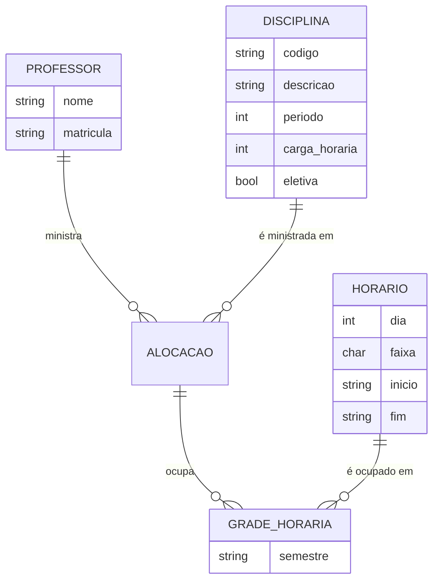
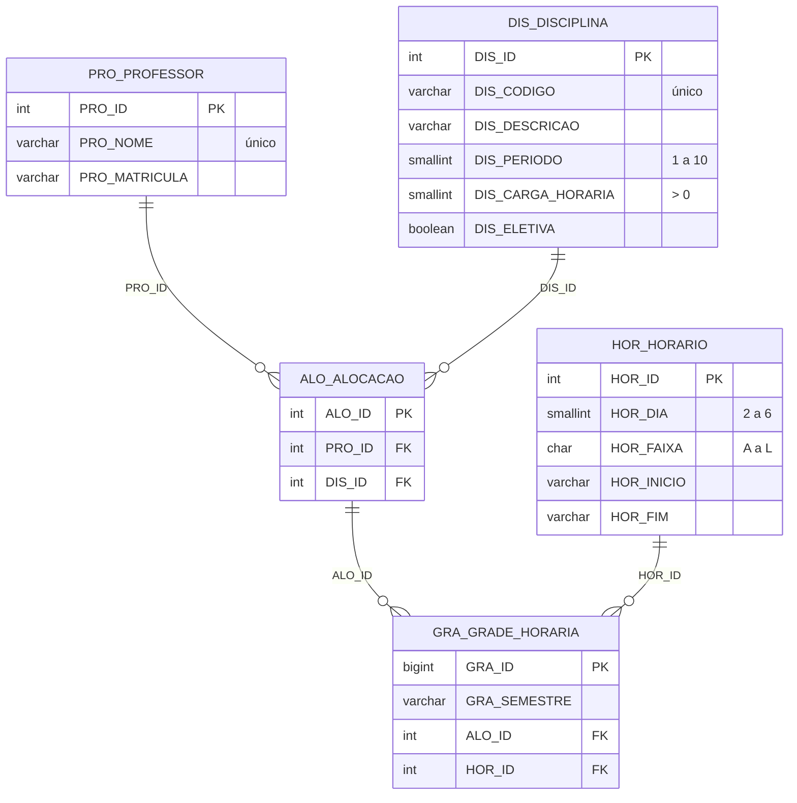

# Modelo de dados

Item 4 do backlog (Iteração 03). Este documento traz as três visões pedidas
pela professora (conceitual, lógica e física) já com as correções apontadas no
card **Modelo de Dados** do Trello e na devolutiva de 20/09.

> As visões conceitual e lógica abaixo são a **proposta** com as correções. O
> banco em uso continua o da equipe de dados no Supabase (seção 3), com as
> siglas `DI_` e `HO_`.

## Correções aplicadas

| Problema apontado | Como ficou |
|---|---|
| Faltou anexar a entrega (modelo ou link) | Este documento está no repositório e linkado no card. |
| Nomenclatura dos objetos ruim (exemplo: `PRO_PROFESSOR` com `PRO_ID`, `PRO_NOME`, `PRO_MATRICULA`) | Toda tabela é `SIGLA_ENTIDADE` e toda coluna é `SIGLA_ATRIBUTO`. |
| Erro conceitual: o modelo deve ter PROFESSOR (ID, NOME, MATRÍCULA), DISCIPLINA (ID, CÓDIGO, DESCRIÇÃO, PERÍODO), ALOCAÇÃO (PROFESSOR x DISCIPLINA) e GRADE HORÁRIA (ID, SEMESTRE, PROFESSOR, DISCIPLINA, HORÁRIO) | São exatamente as entidades do modelo, mais `HOR_HORARIO`, que é a "cor" do grafo. A grade referencia professor e disciplina pela alocação. |
| Padronizar o nome dos objetos com siglas de **3 letras** | Proposta: `DI_DISCIPLINA` e `HO_HORARIO` (2 letras) passam a `DIS_DISCIPLINA` e `HOR_HORARIO`. No Supabase ainda estão com 2 letras. |

Atributos propostos para atender a Iteração 04 (US-01) e a Iteração 06 (US-03), ainda não criados no Supabase:

- `DIS_CARGA_HORARIA`: cada disciplina recebe carga / 15 faixas por semana.
- `DIS_ELETIVA`: eletivas do mesmo período podem coincidir entre si (ver `back-end/graphs/MODELAGEM.md`).
- `HOR_DIA`/`HOR_FAIXA`: o horário segue o padrão da POLI usado no GradeProfessor.pdf (dia 2 a 6 + faixa A a L; ex.: `2C` = segunda, 08:50).

## 1. Modelo conceitual

- Um **professor** ministra várias disciplinas e uma **disciplina** pode ter mais de um professor (ex.: turmas diferentes). A **alocação** é essa relação professor x disciplina.
- A **grade horária** de um semestre diz, para cada alocação, quais **horários** (faixas) ela ocupa.
- O **grafo de conflitos** não é guardado no banco: ele é montado a partir das alocações (vértices) e das regras de conflito (arestas). A coloração do grafo é que gera as linhas da grade.

## 2. Modelo lógico

| Tabela | Chave primária | Chaves estrangeiras | Unicidade |
|---|---|---|---|
| `PRO_PROFESSOR` | `PRO_ID` | – | `PRO_NOME` |
| `DIS_DISCIPLINA` | `DIS_ID` | – | `DIS_CODIGO` |
| `HOR_HORARIO` | `HOR_ID` | – | (`HOR_DIA`, `HOR_FAIXA`) |
| `ALO_ALOCACAO` | `ALO_ID` | `PRO_ID` → `PRO_PROFESSOR`, `DIS_ID` → `DIS_DISCIPLINA` | (`PRO_ID`, `DIS_ID`) |
| `GRA_GRADE_HORARIA` | `GRA_ID` | `ALO_ID` → `ALO_ALOCACAO`, `HOR_ID` → `HOR_HORARIO` | (`GRA_SEMESTRE`, `ALO_ID`, `HOR_ID`) |

Os `HOR_ID` vão de 1 (segunda, faixa A, 07:10) a 60 (sexta, faixa L, 16:20), na ordem dia e depois faixa.

## 3. Modelo físico (em uso no Supabase)

O banco em uso é o da equipe de dados no Supabase. As tabelas ainda usam as siglas antigas `DI_` e `HO_`; renomear para `DIS_` e `HOR_` e acrescentar carga horária e eletiva fica com a equipe de dados.

| Tabela | Colunas | Linhas |
|---|---|---|
| `PRO_PROFESSOR` | `PRO_ID`, `PRO_NOME`, `PRO_MATRICULA` | 26 |
| `DI_DISCIPLINA` | `DI_ID`, `DI_CODIGO`, `DI_DESCRICAO`, `DI_PERIODO` | 47 |
| `HO_HORARIO` | `HO_ID`, `HO_DIA` (ex.: Segunda), `HO_FAIXA` (ex.: 07:10-08:00), `HO_COR` | 60 |
| `ALO_ALOCACAO` | `ALO_ID`, `PRO_ID`, `DI_ID` | 48 |
| `GRA_GRADE_HORARIA` | `GRA_ID`, `GRA_SEMESTRE`, `ALO_ID`, `HO_ID` | 179 (semestre 2026.2) |

O grafo lê essas tabelas por [`back-end/graphs/dados.py`](../back-end/graphs/dados.py), que converte `HO_ID` para o padrão dia + faixa (ex.: `2C`) e calcula a carga horária pelas faixas de cada disciplina na grade atual.

## Carga de dados

A carga é da equipe de dados: [`back-end/database/data_ingestion/data_ingestion.py`](../back-end/database/data_ingestion/data_ingestion.py) lê a planilha `back-end/database/data/modelo_grade_professor.xlsx` (uma aba por tabela) e grava no Supabase, pulando as tabelas que já têm dados.
